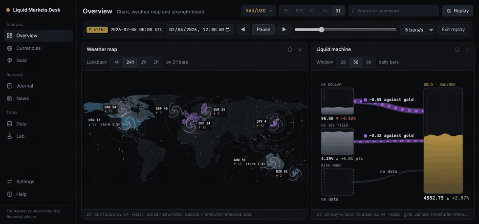

# Liquid Markets Desk



**Live demo:** https://rvrdn-mn.github.io/Liquid-Economy/
(published by the workflow in this repository once GitHub Pages is switched
on for it; see [Publishing](#publishing))

Gold and forex terminal with living market visuals. A browser-based desk for
XAU/USD and the 28 major pairs, with the dense, keyboard-driven feel of a
market terminal and two views of its own: a **weather map** of currency
strength and a **liquid machine** showing what is moving gold.

**For market context only. Not financial advice.** No buy or sell signals,
no predictions, no order placement, no accounts, no AI calls at runtime, and
no server: it runs entirely in your browser.

## Finding your way around

The sidebar has the pages. Each is a calm arrangement of a few panels that
you can resize or change.

| Page | What is on it |
| --- | --- |
| Overview | The chart, the weather map and the strength board |
| Currencies | Weather map, strength board, volatility, linked pairs, session clock |
| Gold | The liquid machine and the gold drivers table |
| Journal | Trade statistics beside a chart with your entries and exits |
| News | Press-release headlines from central banks |
| Data | Import price files; see what is loaded |
| Lab | The Liquid Economy lab, a what-if teaching model kept apart from the analysis |
| Settings, Help | Every adjustable default; how to read each view |

Along the top, for every page at once:

- **Instrument** (a searchable list) and **timeframe**.
- **Replay**: rewind every panel to a past moment, then step or play.
- **Live gold price**, with its age.
- **Search or command**: press `/` and type an instrument (`XAU`,
  `EURUSD`), a timeframe (`H1`), a page (`JOURNAL`) or a panel code
  (`WX`). Several can go on one line: `XAU H1`. Unknown input shows the
  closest matches instead of an error.

Each panel has a small "i" that explains how to read it, so the numbers
have the space the rest of the time. Every panel also says where its data
came from and how old it is. Nothing is shown as live unless it is, and
missing data is shown as missing. The arrangement of each page, your
settings and your imported files are saved in your browser; nothing is
uploaded.

Panel codes, for the command bar: `CHART`, `STR` strength board, `WX`
weather map, `DRV` gold drivers, `LIQ` liquid machine, `SES` session
clock, `VOL` volatility, `LINK` linked pairs, `NEWS`, `JRN` journal,
`RPL` replay, `FILES`, `SET` settings, `LAB`, `HELP`. `CAL` (calendar) is
left out of version 1: no free calendar source was found whose terms
allow it.

### What you see before importing anything

- **Sample set:** one reference rate per day for gold and the 28 pairs,
  about a year, from Frankfurter. Real published rates, but not intraday
  market prices: they have no daily range and gold trails the market by
  about a day.
- **US 10-year yield:** fetched from the US Treasury, with a saved copy as
  fallback.
- **Live gold price:** from gold-api.com, with its age shown.
- **Headlines:** from five central banks, copied when the site is built.
- **Demo journal:** invented example trades, marked DEMO. Nobody placed
  them.

### Importing your own data

On the Data page:

- **Price files.** One-minute files from histdata.com (MetaTrader format)
  work as they are; MT4/MT5 exports and TradingView chart exports are also
  read. A one-minute file serves every timeframe, and files for XAUUSD and
  the seven dollar pairs (EURUSD, GBPUSD, AUDUSD, NZDUSD, USDCAD, USDCHF,
  USDJPY) cover all 28 pairs.
- **Risk mood.** Any daily "date, value" CSV, such as a volatility index
  history.

On the Journal page: your trade history, as a table with a header row. See
[docs/CALCULATIONS.md](docs/CALCULATIONS.md#journal-statistics-jrn) for the
layout.

Check the terms of any file you import. Your files stay in your browser.

## How the numbers are made

Plain arithmetic on price bars, in small tested functions kept apart from
the drawing code. [docs/CALCULATIONS.md](docs/CALCULATIONS.md) explains
each one in plain language and says how it was checked.

## Where the data comes from

[docs/DATA_SOURCES.md](docs/DATA_SOURCES.md) lists every source, its delay
and its terms, including the ones that were checked and turned down. In
short: no free feed gives intraday forex with the right to show it
publicly, so intraday data comes from files you import.

## Run it yourself

Needs Node 22.18 or later.

```sh
npm install
npm run dev      # the terminal, at the address it prints
npm test         # unit tests
npm run build    # static site in dist/
```

Refreshing the shipped data (each script says what it fetches):

```sh
npm run samples:fetch     # daily reference rates
npm run samples:yield     # US 10-year yield snapshot
npm run samples:journal   # the demo journal
npm run news:fetch        # central-bank headlines
npm run map:build         # weather-map outlines
```

## Publishing

`.github/workflows/deploy.yml` tests, refreshes the headlines, builds and
publishes to GitHub Pages on every push to `main`, and again every six
hours so the headlines stay fresh. One setting has to be switched on once,
by the repository owner: **Settings → Pages → Source: GitHub Actions**.

## Code layout

```
src/data/      data layer: adapters, file readers, bar building, browser storage, hub
src/calc/      calculations: pure functions, no data access, no drawing
src/app/       command language, pages, layout tree, saved state, analysis layer (no drawing)
src/ui/        sidebar, header controls, replay bar, panel grid, command bar
src/panels/    one file or folder per panel; panels get data only from the hub
tests/         unit tests
public/        sample prices, yield snapshot, demo journal, headlines
scripts/       scripts that regenerate the files in public/
docs/          calculations, data sources, the demo clip
```

Three layers are kept apart: data adapters, calculation functions, and
panels. Panels never fetch data themselves.

## Licence and credits

[MIT](LICENSE). Charts are drawn with
[TradingView Lightweight Charts](https://www.tradingview.com/lightweight-charts/)
(Apache 2.0); map outlines are from Natural Earth (public domain). See
[THIRD_PARTY_NOTICES.md](THIRD_PARTY_NOTICES.md).
